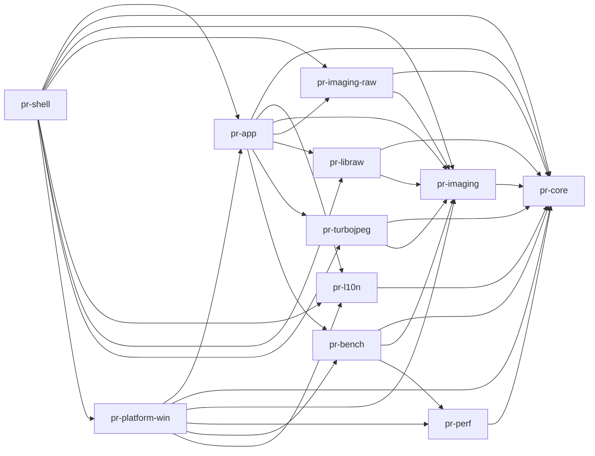

# Architecture

## Crates and dependency direction

Arrows point from dependent to dependency: `app --> core` means `pr-app` depends on `pr-core`. Solid arrows are normal `[dependencies]` and `[target.*.dependencies]` edges from the manifests; dev dependencies are omitted.

`pr-test-support` is a dev-dependency of test consumers, not a production edge. `pr-core` has no workspace-crate dependency in `[dependencies]`; `pr-app` and `pr-platform-win` both depend on `pr-bench`, which makes shared benchmark types available at both layers.

`pr-core` contains platform independent application data and services and must not depend on UI or Windows crates. `pr-app` contains app/UI logic, view models, coordinators, presenters and services; the executable composition root is in `pr-shell`. `pr-platform-win` implements Windows and rendering adapters and depends on `pr-app` contracts. The actual edges are in each `crates/*/Cargo.toml`.

| Crate | Responsibility |
|---|---|
| `pr-core` | Catalog, settings, sessions, file actions, journal, abstractions and shared models. |
| `pr-imaging` | Image decode service, preload, cache, metadata and pixel handling. |
| `pr-imaging-raw` | RAW container parsing, format routing and embedded preview selection. |
| `pr-app` | App/UI logic, view models, coordinators, presenters and service traits; executable composition root is in `pr-shell`. |
| `pr-platform-win` | Windows adapters, Win32, Shell, WIC, graphics and native hosting. |
| `pr-shell` | Thin executable, startup and composition root. |
| `pr-l10n` | Localizer over shared JSON language catalogs. |
| `pr-perf` | Performance session CSV analysis and reporting. |
| `pr-libraw` | Dynamically linked LibRaw sensor decoder. |
| `pr-turbojpeg` | TurboJPEG decoder backend. |
| `pr-bench` | Shared benchmark engine and CLI. |
| `pr-test-support` | Shared fakes and golden helpers; never a production dependency. |

## Module map

Each entry is based on that module's opening `//!` documentation or first module doc comment. Paths identify the module source.

| Crate/module | Purpose from module docs |
|---|---|
| `pr-core::abstractions` | Production seams; blocking interfaces mapped from C# abstractions. (`crates/pr-core/src/abstractions/mod.rs`) |
| `pr-core::app_paths` | Port of `AppPaths.cs`, with the application data root renamed. (`crates/pr-core/src/app_paths.rs`) |
| `pr-core::caching` | LRU cache implementation for shared core data. (`crates/pr-core/src/caching/mod.rs`) |
| `pr-core::catalog` | `ReviewCatalog`, capture groups, comparison and drag/drop data, Explorer ordering types, sorting, and snapshot validation. (`crates/pr-core/src/catalog/mod.rs`) |
| `pr-core::diagnostics` | Logs and performance listeners. (`crates/pr-core/src/diagnostics/mod.rs`) |
| `pr-core::display` | `VBlankEstimator`. (`crates/pr-core/src/display/mod.rs`) |
| `pr-core::file_actions` | File action services and journal. (`crates/pr-core/src/file_actions/mod.rs`) |
| `pr-core::identity` | Names that separate this app from the C# app. (`crates/pr-core/src/identity.rs`) |
| `pr-core::instance` | Single-instance ownership and path forwarding. (`crates/pr-core/src/instance/mod.rs`) |
| `pr-core::io` | Physical filesystem and I/O helpers. (`crates/pr-core/src/io/mod.rs`) |
| `pr-core::model` | Persisted enums, title-bar and photo-info flag sets, and lenient JSON conversion. (`crates/pr-core/src/model/mod.rs`) |
| `pr-core::session` | Review session store and writer. (`crates/pr-core/src/session/mod.rs`) |
| `pr-core::settings` | App settings, context-menu settings, normalization, performance options, shortcuts, and settings storage. (`crates/pr-core/src/settings/mod.rs`) |
| `pr-core::sync` | Cancellation mapping. (`crates/pr-core/src/sync.rs`) |
| `pr-core::text` | .NET `StringComparison.OrdinalIgnoreCase` path/name behavior. (`crates/pr-core/src/text/mod.rs`) |
| `pr-core::time` | UTC instant with .NET `DateTime` semantics. (`crates/pr-core/src/time.rs`) |
| `pr-core::updates` | Update-checker logic and version representation. (`crates/pr-core/src/updates/mod.rs`) |
| `pr-imaging::adaptive_preview` | Adaptive preview policy. (`crates/pr-imaging/src/adaptive_preview.rs`) |
| `pr-imaging::cache` | Disk and RAM caches. (`crates/pr-imaging/src/cache/mod.rs`) |
| `pr-imaging::cache_key` | Identity for decoded image cache entries. (`crates/pr-imaging/src/cache_key.rs`) |
| `pr-imaging::decode_types` | Decode request/image types. (`crates/pr-imaging/src/decode_types.rs`) |
| `pr-imaging::decoder_traits` | Decoder interface/exception types. (`crates/pr-imaging/src/decoder_traits.rs`) |
| `pr-imaging::embedded_thumbnail` | Embedded thumbnail reader. (`crates/pr-imaging/src/embedded_thumbnail.rs`) |
| `pr-imaging::exif_parser`, `exif_query`, `exif_summary` | EXIF parsing, query interpretation and summary/codec. (`crates/pr-imaging/src/exif_parser.rs`, `exif_query.rs`, `exif_summary.rs`) |
| `pr-imaging::factory` | Image decoder factory. (`crates/pr-imaging/src/factory.rs`) |
| `pr-imaging::fallback` | Fallback image decoder. (`crates/pr-imaging/src/fallback.rs`) |
| `pr-imaging::memory_headroom` | Shared RAM-budget check. (`crates/pr-imaging/src/memory_headroom.rs`) |
| `pr-imaging::navigation_pace` | Navigation pacing. (`crates/pr-imaging/src/navigation_pace.rs`) |
| `pr-imaging::orientation` | EXIF orientation/transforms. (`crates/pr-imaging/src/orientation.rs`) |
| `pr-imaging::pixel_memory`, `pixels` | Native pixel memory and pixel buffers/operations. (`crates/pr-imaging/src/pixel_memory.rs`, `pixels.rs`) |
| `pr-imaging::preload` | Background preload scheduler. (`crates/pr-imaging/src/preload/mod.rs`) |
| `pr-imaging::preload_backoff`, `preload_order` | Preload backoff/sampling and preload window/order. (`crates/pr-imaging/src/preload_backoff.rs`, `preload_order.rs`) |
| `pr-imaging::ram_budget` | Decoded-image memory estimates and RAM-budget policy. (`crates/pr-imaging/src/ram_budget.rs`) |
| `pr-imaging::service` | Preview image service: decode, RAM cache, in-flight de-duplication and cache epoch. (`crates/pr-imaging/src/service/mod.rs`) |
| `pr-imaging::tiff` | Low-level TIFF reader and IFD parser. (`crates/pr-imaging/src/tiff.rs`) |
| `pr-imaging::webp_heic` | WebP/HEIC routing decoder. (`crates/pr-imaging/src/webp_heic.rs`) |
| `pr-imaging-raw::bmff` | ISO-BMFF box parser/walker. (`crates/pr-imaging-raw/src/bmff.rs`) |
| `pr-imaging-raw::contracts` | RAW container/preview/header contracts. (`crates/pr-imaging-raw/src/contracts.rs`) |
| `pr-imaging-raw::decoder` | RAW decoder construction and decode pipeline. (`crates/pr-imaging-raw/src/decoder.rs`) |
| `pr-imaging-raw::formats` | RAW formats, file types, container info and limits. (`crates/pr-imaging-raw/src/formats.rs`) |
| `pr-imaging-raw::header_source` | Production RAW header source. (`crates/pr-imaging-raw/src/header_source.rs`) |
| `pr-imaging-raw::jpeg_probe` | JPEG marker probe. (`crates/pr-imaging-raw/src/jpeg_probe.rs`) |
| `pr-imaging-raw::preview_selector` | Embedded RAW preview selection. (`crates/pr-imaging-raw/src/preview_selector.rs`) |
| `pr-imaging-raw::raw_exif` | RAW EXIF port. (`crates/pr-imaging-raw/src/raw_exif.rs`) |
| `pr-imaging-raw::readers` | Camera RAW container readers, grouped by format family. (`crates/pr-imaging-raw/src/readers/mod.rs`) |
| `pr-imaging-raw::registry` | Container reader registry and JPEG ICC profile. (`crates/pr-imaging-raw/src/registry.rs`) |
| `pr-imaging-raw::routing` | Format routing decoder. (`crates/pr-imaging-raw/src/routing.rs`) |
| `pr-imaging-raw::tiff_nav` | TIFF IFD navigation over random-access headers. (`crates/pr-imaging-raw/src/tiff_nav.rs`) |
| `pr-app::coordinators` | Coordinator seams and small coordinators. (`crates/pr-app/src/coordinators/mod.rs`) |
| `pr-app::input` | Input layer. (`crates/pr-app/src/input/mod.rs`) |
| `pr-app::localization` | Localization service and export. (`crates/pr-app/src/localization/mod.rs`) |
| `pr-app::menus` | Menu model and builders. (`crates/pr-app/src/menus/mod.rs`) |
| `pr-app::misc` | Logging, build info, launch args and hashing helpers. (`crates/pr-app/src/misc/mod.rs`) |
| `pr-app::overlay` | Overlay element tree. (`crates/pr-app/src/overlay/mod.rs`) |
| `pr-app::presenters` | Action-list JSON, action profiles, benchmark/recovery presentation and settings form state. (`crates/pr-app/src/presenters/mod.rs`) |
| `pr-app::services` | App services. (`crates/pr-app/src/services/mod.rs`) |
| `pr-app::startup` | Startup logic needing no window or `windows` crate. (`crates/pr-app/src/startup/mod.rs`) |
| `pr-app::viewing` | Pure viewing logic using pr-app types. (`crates/pr-app/src/viewing/mod.rs`) |
| `pr-app::viewmodels` | View models. (`crates/pr-app/src/viewmodels/mod.rs`) |
| `pr-app::viewport` | Viewport state, layout and fit. (`crates/pr-app/src/viewport/mod.rs`) |
| `pr-app::windowing` | Window placement and fullscreen. (`crates/pr-app/src/windowing/mod.rs`) |
| `pr-platform-win` Explorer group | `explorer_com_interop`, `explorer_native_view`, `explorer_window_selector`, `explorer_order_service`, `explorer_order_provider` - Explorer COM interop, native view/order querying, selection, service lifecycle and production provider. Each file's opening docs: `crates/pr-platform-win/src/explorer_*.rs`. |
| `pr-platform-win` instance group | `instance_keys`, `instance_scope`, `forward_pipe`, `forward_server`, `forward_client` - instance identity/scope and forwarding protocol/server/client. (`crates/pr-platform-win/src/{instance_keys,instance_scope,forward_pipe,forward_server,forward_client}.rs`) |
| `pr-platform-win` recycle group | `recycle_bin`, `recycle_candidate`, `recycle_bin_shell`, `recycle_restore`, `recycle_bin_settings`, `recycle_bin_capacity`, `recycle_eligibility`, `restore_verb` - recycle operations, Shell adapter, restore, capacity, eligibility and verb policy. (`crates/pr-platform-win/src/recycle_*.rs`, `restore_verb.rs`) |
| `pr-platform-win` Windows service files | `culture`, `dark_title_bar`, `display_clock`, `live_operation_registry`, `memory_probe`, `natural_comparer`, `physical_memory`, `shell_integration`, `vblank_driver` - culture/time-zone, title bar, display clock, live operations, memory, natural ordering, shell integration and vblank driver. (`crates/pr-platform-win/src/*.rs`, each module's opening doc) |
| `pr-platform-win::dialogs` | Native dialogs and settings UI. (`crates/pr-platform-win/src/dialogs/mod.rs`) |
| `pr-platform-win::gfx` | Thin graphics interop helpers over `windows-rs`. (`crates/pr-platform-win/src/gfx/mod.rs`) |
| `pr-platform-win::host` | Window host, clocks, message loop, dispatcher and window procedure; UI-thread code. (`crates/pr-platform-win/src/host/mod.rs`) |
| `pr-platform-win::render` | Direct2D implementation of app render traits. (`crates/pr-platform-win/src/render/mod.rs`) |
| `pr-platform-win::shell_input` | Win32 input layer. (`crates/pr-platform-win/src/shell_input/mod.rs`) |
| `pr-platform-win::shell_menus` | Win32 menus. (`crates/pr-platform-win/src/shell_menus/mod.rs`) |
| `pr-platform-win::shell_overlay` | Win32 overlay HUD parts. (`crates/pr-platform-win/src/shell_overlay/mod.rs`) |
| `pr-platform-win::shell_startup` | Native startup parts including DPI, placement/cloak and warmups. (`crates/pr-platform-win/src/shell_startup/mod.rs`) |
| `pr-platform-win::shell_viewing` | Viewing adapters that need no pr-app types. (`crates/pr-platform-win/src/shell_viewing/mod.rs`) |
| `pr-platform-win::wic` | Windows Imaging Component COM layer. (`crates/pr-platform-win/src/wic/mod.rs`) |
| `pr-platform-win::win32` | Win32 foundation: custom constants, layouts and wrappers. (`crates/pr-platform-win/src/win32/mod.rs`) |
| `pr-platform-win::spike_ui` | Phase 0 Win32 window, Direct2D target, DirectWrite text and WIC fixture writer. (`crates/pr-platform-win/src/spike_ui.rs`) |
| `pr-platform-win` test helpers | `test_support` - process metrics; `ui_driver` - posts input messages; `exe_resources` - reads executable resources without running it. (`crates/pr-platform-win/src/{test_support,ui_driver,exe_resources}.rs`) |
| `pr-shell::composition` | Explicit builders/plain functions; service graph, adapters and platform glue. (`crates/pr-shell/src/composition/mod.rs`) |
| `pr-shell::startup` | Shell composition and startup. (`crates/pr-shell/src/startup/mod.rs`) |
| `pr-shell::spike` | Phase 0 UI spike; safe view/stat logic and viewer over platform spike. (`crates/pr-shell/src/spike/mod.rs`) |
| `pr-shell::entry` | Rust process entry point. (`crates/pr-shell/src/entry.rs`) |
| `pr-shell` executable files | `main.rs` calls the entry point; `bin/r0001_spike.rs` is the feature-gated spike executable. (`crates/pr-shell/src/main.rs`, `crates/pr-shell/src/bin/r0001_spike.rs`) |
| `pr-bench::bench_recycle_bin` | Benchmark recycle-bin support. (`crates/pr-bench/src/bench_recycle_bin.rs`) |
| `pr-bench::cli` | Command-line front end of the benchmark tool. (`crates/pr-bench/src/cli/mod.rs`) |
| `pr-bench::main` | `pr-bench` command line program. (`crates/pr-bench/src/main.rs`) |
| `pr-bench::engine`, `image_executor`, `metrics`, `models`, `profiles`, `slow_link_fs`, `slow_link_reader`, `workload_runner` | Benchmark engine, image executor, metrics, models, profiles, slow-link filesystem/reader and workload runner, as named in the crate module docs. (`crates/pr-bench/src/lib.rs`) |

## Threading and cancellation

The concurrency mapping follows [R0003](adr/R0003-concurrency.md). There is one UI thread owned by `pr-app`; only that thread touches UI state. Other work returns through `UiScheduler::post` or `invoke`. `pr-imaging` sizes a Rayon pool for CPU-bound decode/resample work, not file I/O. Dedicated named threads and `crossbeam-channel` carry foreground reads, preload reads, journal/session writes and Explorer COM work.

C# tasks map to blocking functions on the correct lane or queued work returning a receiver/completion handle; there is no async runtime or `block_on`. Cancellation uses `pr_core::sync::CancelToken`; generation-tagged stale results are discarded on arrival. Locks are not held across I/O, decode, COM or UI scheduler calls. Worker panics are reported as errors.

## Open-folder to presented-image path

The UI-facing steps run on the UI thread; folder scans and Explorer queries use their named worker lanes, decode runs on the imaging decode threads, and source reads use the dedicated I/O lanes ([R0003](adr/R0003-concurrency.md)). The shell composition files currently contain `todo!()` stubs, noted below where they interrupt the production wiring.

1. **Open and enumerate.** `MainViewModel::open_folder` in `crates/pr-app/src/viewmodels/main/navigation.rs` calls `open_folder_core` and `start_load`, which invokes `FolderLoadCoordinator::load` (`crates/pr-app/src/coordinators/folder_load/load.rs`). On the UI thread, `load` normalizes and checks the directory and submits `run_scan` to `WorkerLane::Scan`; `run_scan` calls `FileSystem::enumerate_files_with_stat`, filters supported images and RAW sidecars, builds `CatalogEntry` values, and sorts them. If the selected sort needs Explorer order, `submit_explorer_query` uses `ExplorerOrderProvider::try_get_snapshot_progressive` on `WorkerLane::Explorer`.
2. **Build catalog and choose initial entry.** The scan completion returns to `FolderLoadCoordinator::on_scan_finished` on the UI thread. It loads the session, calls `ReviewCatalog::reset`, invokes `IFolderLoadSink::on_catalog_ready`, validates an available Explorer snapshot with `try_validate` from `crates/pr-core/src/catalog/snapshot_validator.rs`, and applies it with `ReviewCatalog::replace_order`. It selects the resumed path or index zero, calls `ReviewCatalog::set_current`, then `IFolderLoadSink::present` (`crates/pr-app/src/coordinators/traits.rs`). `ReviewCatalog` and `entries_snapshot` are defined in `crates/pr-core/src/catalog/review_catalog.rs`.
3. **Request the first preview and preload neighbors.** The folder sink routes presentation to `ImagePresenter::present` in `crates/pr-app/src/coordinators/presenter/present_a.rs`. After the initial stat and cache-key lookup, a RAM hit goes directly to `present_preview`; otherwise `begin_preview_race` calls `PreviewImageService::get_viewer_preview` and waits on its `PreviewHandle` on `PREVIEW_WAIT_THREAD`. `present_preview` assigns the image, calls `sink.on_presented`, and kicks `IPreloadController::preload_around`. `PreloadScheduler::with_thresholds` accepts the entry-snapshot and version closures; `preload_around` drives a run on the `pr-preload-run` thread (`crates/pr-imaging/src/preload/scheduler.rs`). Shell wiring is specified in `crates/pr-shell/src/composition/main_view_model.rs` and `registry.rs`: `CatalogFeed::publish_if_changed` snapshots via `ReviewCatalog::entries_snapshot`, then `entries_fn`/`version_fn` feed the scheduler factory. These shell composition methods are currently `todo!()` stubs. `PreviewImageService` is the decode target and also implements prewarm in `crates/pr-app/src/services/prewarm.rs`.
4. **Decode, cache, and select decoder.** `PreviewImageService::get_viewer_preview` enters `get_preview_attempt` and `decode_and_cache` in `crates/pr-imaging/src/service/decode.rs`: it checks the disk cache (`crates/pr-imaging/src/service/disk.rs`), reads source bytes through the configured source reader when needed, calls `get_decoder(...).decode`, verifies the source identity, publishes into the RAM cache, and hands off disk persistence. `PreviewHandle::wait` is blocking and is used by the background waiter, not the UI thread (`crates/pr-imaging/src/service/handle.rs`). Shell decoder providers in `crates/pr-shell/src/composition/decoders.rs` include WIC (`WicDirectDecoder` in `crates/pr-platform-win/src/wic/decoder.rs`), `TurboJpegDecoder`, and `LibRawDecoder`; `crates/pr-shell/src/composition/factories.rs` wraps the selected standard decoder with `RawDecoder` for RAW input. The shared registry wiring is also currently stubbed.
5. **Deliver and reject stale results.** The preview waiter sends `PresenterEvent::Preview` through the presenter's inbox; the inbox wake callback causes the shell to post `pump` to the UI thread, where `ImagePresenter::pump` processes it (`crates/pr-app/src/coordinators/presenter/state.rs`). `on_preview` in `crates/pr-app/src/coordinators/presenter/present_a.rs` takes the matching navigation and `present_preview` checks `GenerationClock::is_navigation_current(token)` before assigning the image. `UiScheduler::post` is used for deferred UI work; R0003 requires background work to return to UI state through the scheduler.
6. **Draw and present.** `ImagePresenter::update_current_image` updates the presentation sink; the Windows presentation path calls `ImageLayer::try_draw` in `crates/pr-app/src/viewing/image_layer.rs`, which uploads through `GpuImageCache` and calls the app `DrawContext` trait in `crates/pr-app/src/services/render/surface.rs`. `D2dRenderSurface` implements the render traits in `crates/pr-platform-win/src/render/surface.rs`. On the UI thread, `MainWindowInner::present` and `draw_content` in `crates/pr-platform-win/src/host/main_window/frame.rs` draw the frame and call `end_draw_and_present` to present it.

## Native code and rendering

Unsafe code is permitted in `pr-platform-win` and FFI crates `pr-libraw` and `pr-turbojpeg`; the crates contain FFI unsafe blocks (including `pr-libraw/src/native.rs`). Every block requires a `// SAFETY:` comment. The reviewed inventory and scope are in [UNSAFE-REVIEW-W8-11.md](UNSAFE-REVIEW-W8-11.md). `pr-platform-win/src/win32/*` contains custom Win32 wrappers; `src/gfx/*` contains D3D11/DXGI/Direct2D/DirectWrite helpers; `src/render/*` implements the Direct2D renderer; `src/host/*` and `src/shell_viewing/*` connect windows and presentation. The crate uses `windows-rs` for generated Win32 and COM declarations.

## Coexistence with the C# application

The Rust application stores its state under `%LOCALAPPDATA%\PhotoReviewRs` and uses a separate instance prefix, executable identity and environment variables. File formats remain compatible with C#; the first-run import may read C# `config.json` only. It never shares or writes the C# app's journal, sessions, cache or logs. See [R0002](adr/R0002-coexistence-with-csharp-app.md) and [AGENTS.md](../AGENTS.md).
