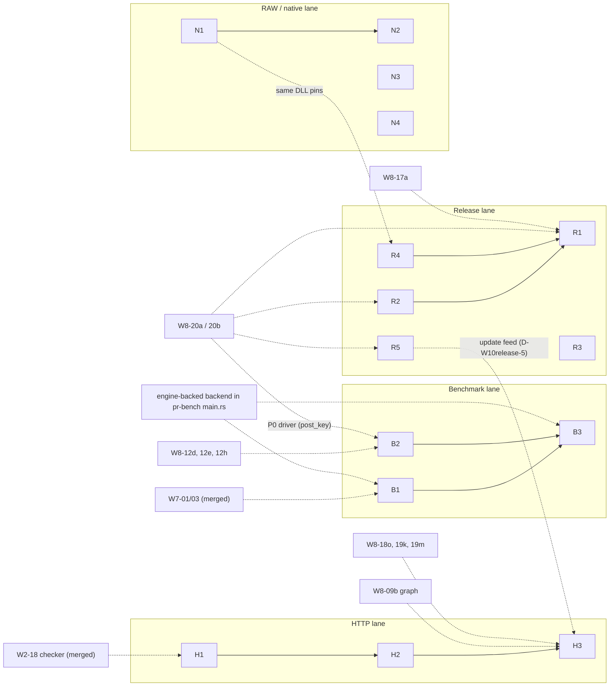

# Wave 10 plan (combined view): update HTTP, release, benchmark parity, RAW/native residual

> **Status: active combined view; Wave 10 is contract and stub only, no W10 unit is implemented.** Last verified 2026-10-26 against `origin/master` 8b93fbf.
> Evidence: the only W10 commits on master are contracts, stubs and their review (#168, #171, #172, #173, #187, #193); `todo!()` remains in `pr_platform_win::http` and `pr_shell::composition::update_http`, and `crates/pr-bench/src/compare.rs` describes itself as a contract stub. Section 4 is the snapshot of 2026-10-23 and is superseded by section 0.

Written by DOC-WAVE-PLANS (machine C, cloud) from `docs/WAVE-10-PLAN-http.md`, `contracts/W10-H1..H3.md`, `W10-R1..R5.md`, `W10-B1..B3.md`, `W10-N1..N4.md` and the "Wave 10" sections of `contracts/README.md` (decisions D-W10http-n, D-W10release-n, D-W10BENCH-n, D-W10RAW-n), plus the `origin/master` history of 2026-10-23. No new design; every decision stays open for the lead as recorded there.

`docs/WAVE-10-PLAN-http.md` stays as the detailed plan of the HTTP lane (unit gates, expected test counts, risks). Wave 10 contracts are **contracts only**: nothing in this wave is implemented.

## 0. Current state (2026-10-26, `origin/master` 8b93fbf)

| Lane | Units | Status on master | Evidence |
|---|---|---|---|
| HTTP | W10-H1..H3 | contract and stub only, not implemented | #171 (`todo!()` in `crates/pr-platform-win/src/http/{policy,transport}.rs`, `crates/pr-shell/src/composition/update_http.rs`) |
| Release | W10-R1..R5 | contract only; drafts not adopted | #172 (`.github/workflows` holds only `ci.yml`; no root `deny.toml`; the proposed `tools/verify-release-native.ps1` does not exist; `docs/drafts/{release.yml,ci-deny-job.yml,deny.toml}` are still drafts) |
| Benchmark | W10-B1..B3 | contract and stub only, not implemented | #168 (`crates/pr-bench/src/compare.rs` is a contract stub) |
| RAW / native | W10-N1..N4 | contract only | #173 |

- Wave 8 dependencies of section 4 that are merged since the snapshot: W8-09b S4 #224, W8-17d #223, W8-18o #231, W8-19j..19m #230. Still not on master: W8-17e, W8-20a, W8-20b and the conditional W8-12j, so R1, R2 and R5 stay gated as written in section 3.
- Section 6 (machine split) is still a proposal: `docs/MULTI-MACHINE.md` has no Wave 10 row; the Wave 8 B5 remainder that section 6 says machine A is still porting is complete (B5 35/35 per `tools/dev/dashboard.sh`).

## 1. Units at a glance

| Unit | What | Rust / file area | Test | Plan edges (from the contracts) |
|---|---|---|---|---|
| W10-H1 | Pure HTTP policy (redirects, proxy order, deadline, errors) | `pr_platform_win::http::policy` | F | code: W2-18 checker |
| W10-H2 | WinHTTP transport, streamed body, cancel | `pr_platform_win::http::transport` | F / N | H1 |
| W10-H3 | Inject checker into Settings, finish manual check | `pr_shell::composition::{update_http, graph}`, `startup::secondary_dialogs` | F / N | H2; W8-09b graph; W8-18o, 19g, 19k, 19m |
| W10-R1 | Release workflow for `PhotoReviewRs.exe` | `.github/workflows/release.yml` (new; draft `docs/drafts/release.yml`) | CI + tagged smoke | R2, R4, W8-17a, W8-20a, W8-20b |
| W10-R2 | Exe icon, manifest, version resource | `pr_shell` build support | F | W8-20a resource writer; P-47; icon sync |
| W10-R3 | cargo-deny licence and supply-chain gate | `deny.toml` (draft `docs/drafts/deny.toml`, `ci-deny-job.yml`) | CI | lockfile licence review, CI owner |
| W10-R4 | Pinned native DLLs and notices | `tools/verify-release-native.ps1` (new) | script | C# native pins; licence and source review |
| W10-R5 | Coexistence with the C# app | `pr_core::{identity, app_paths}`, update feed | F | R0002; update-checker correction; W8-20a process test |
| W10-B1 | Benchmark comparison harness | `pr_bench::compare` | F | W7-01a, 01b, 03a, 03c, 03d; engine-backed backend in `pr-bench/src/main.rs` |
| W10-B2 | Attended production re-measure protocol | R0001 evidence | manual | W8-12d, 12e, 12h; P0 measurement driver |
| W10-B3 | Phase 7 parity report (Markdown + JSON) | `pr_bench` report | F | B1, B2; engine-backed backend |
| W10-N1 | Stage pinned native DLLs | `native/x64/` procedure | hash check | none |
| W10-N2 | Run native DLL tests | `pr-libraw`, `pr-turbojpeg` ignored tests | N (Windows x64) | N1 |
| W10-N3 | Consent-gated RAW corpus and strict run | `pr_test_support::raw`, RAW tests | N | owner consent (P-30, D-W10RAW-3) |
| W10-N4 | Reconcile Wave 5 mutation survivors | W5 test suites | ledger | none |

## 2. Dependency graph

Edges between lanes are written in the contracts: R1 and R4 describe the same two DLLs that N1 stages (R4 notes that `native.rs` loads them next to the exe); R5 says the Rust update checker must be corrected, and D-W10release-5 lists the feed options that H3 then wires. They are coordination points, not hard plan edges.

## 3. Suggested order

1. Independent starts: **H1**, **R3** (once a CI owner and the lockfile licence review exist), **N1**, **N4**, **B1** (pure compare; the engine-backed backend is a separate precondition for any parity claim, D-W10BENCH-3).
2. Then **H2** (after H1), **N2** (after N1, on an attended Windows x64 desktop), **R4** (needs the licence and source review of D-W10release-6).
3. Gated by Wave 8 and by the lead:
   - **R2, R5, R1** wait for W8-20a/20b; R2 also for P-47 / D-W10release-3.
   - **H3** waits for W8-09b S4 and the Settings dialog units.
   - **B2** waits for the P0 measurement driver and an attended session; **B3** after B1 and B2.
   - **N3** only after the owner's explicit consent (P-30).
4. Decisions to take before the dependent unit starts (all recorded in `contracts/README.md`): tag policy and signing (D-W10release-1/2), RT_VERSION (D-W10release-3, P-47), CI audit tool (D-W10release-4), update feed (D-W10release-5), LibRaw source offer (D-W10release-6), catalog layout (D-W10release-7), runner smoke (D-W10release-8), proxy precedence probe (D-W10http-3).

## 4. State of the Wave 8 dependencies (from `git log origin/master`, 2026-10-23; snapshot, superseded by section 0)

- In history: W8-09b S1..S3 (#158, #159, #175), W8-17c partial (#177), W8-17a/17b (inside #177, tests #179), W8-12d/12e (#100), W8-12h (#99), W7 units (#30, #31), W2-18 (inside the Wave 2 port #8).
- Not found in any merged PR title: W8-09b S4 (graph builder), W8-17d, 17e, 18o, 19j..19m, 20a, 20b, 12j.
- The Rust code still holds `todo!()` in the files the contracts name (for example `crates/pr-shell/src/startup/*`, `crates/pr-platform-win/src/dialogs/settings/dialog/*`); this was counted with `git grep`, not by building.

## 5. Pipeline tags

`tools/autopilot/lib/codex-lib.py` knows tags `wave9-<letter>` and the Wave 8 tags only; any other tag makes `planfor` answer `docs/WAVE-8-PLAN.md`. So `wave10-*` tags are **not** supported by the pipeline today (support was added for Wave 9 in #183). Suggested tags if the pipeline is extended (a change under `tools/`, not part of this documents-only work):

| Lane | Suggested tag | Plan | Comment |
|---|---|---|---|
| HTTP | `wave10-h` | `docs/WAVE-10-PLAN-http.md` (rows `W10-H1..H3` exist there) | pure/fake units H1, H2, H3 fit Codex; N runs are manual |
| Release | `wave10-r` | no plan table yet (this file) | mostly scripts, workflow and resources; needs W8-20a |
| Benchmark | `wave10-b` | no plan table yet | B2 is manual, B1 and B3 fit Codex |
| RAW/native | `wave10-n` | no plan table yet | N1..N3 are attended-desktop or consent-gated; only N4 is bookkeeping |

Until then, run the units by hand with `tools/autopilot/codex-run.sh` per AGENTS.md ("Who does what").

## 6. Machine split (proposal for the lead; the ownership table in `docs/MULTI-MACHINE.md` is not changed here)

| Machine | Units | Why |
|---|---|---|
| A | HTTP lane (H1, H2, H3) and N4 | H3 needs the Settings dialog and graph units that machine A is porting (B5 remainder); N4 is bookkeeping |
| B | Release lane (R2, R1, R5, then R4, R3) | They depend on W8-20a/20b and W8-17a, which machine B owns (B6); R1 also builds on the exe |
| the machine with an attended Windows desktop and the strongest CPU | N1, N2, B2, then B1/B3 runs | Native DLL runs, attended re-measure and long builds need a real desktop; CPU-heavy lanes go to the strongest machine (MULTI-MACHINE section 7). B1 itself is pure code and can go to any machine |
| owner | N3 consent, release decisions of section 3 | Not machine work |

The cloud machine C cannot run Windows native tests, so none of the N/B2 work can be done here.

## 7. Open items copied from the contracts (not resolved by this plan)

- The release workflow draft is not runnable before R2/R4 and W8-20a land (D-W10release open items).
- Parity claims between C# and Rust are barred until the engine-backed benchmark backend replaces `UnwiredBackend` (D-W10BENCH-3).
- `docs/drafts/release.yml`, `ci-deny-job.yml`, `deny.toml` are proposals; none is in `.github/workflows`.
