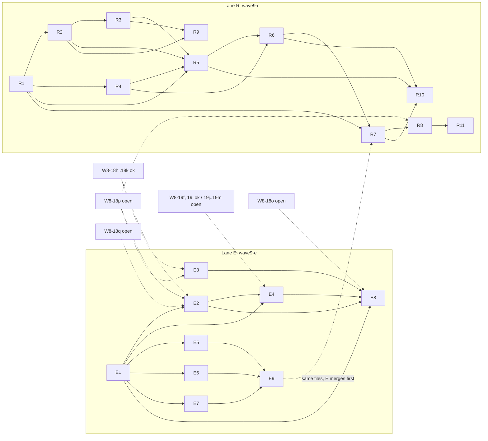

# Wave 9 plan (combined view): external editors (lane E) and FEAT-RENAME (lane R)

Written by DOC-WAVE-PLANS (machine C, cloud) from `docs/WAVE-9-PLAN-edt.md`, `docs/WAVE-9-PLAN-ren.md`, `contracts/W9-E1..E9.md`, `contracts/W9-R1..R11.md`, `contracts/README.md` (sections "Wave 9 sync") and the `origin/master` history of 2026-10-23. Nothing here is new design.

**The two lane plans stay the source of the unit tables.** `tools/autopilot/lib/codex-lib.py planfor` selects a plan by listing `docs/WAVE-9-PLAN-*.md` files that contain rows `| W9-<lane><n> |`, so those files must not be merged, renamed or deleted; this file is named without the dash suffix on purpose and carries no unit rows. C# spec: `7eaee2a2` (feature commit `d9623945` for lane E; `55a37986`, `9800058e`, `170a2d19` for lane R).

## 1. Units at a glance

| Unit | What | Rust area | Test | Colour / model | Plan edges (lane plan) |
|---|---|---|---|---|---|
| W9-E1 | External editor list, settings v4, default-editor shortcut field, two dialog-service methods | `pr_core::settings::*`, `abstractions::dialog` | G + F | yellow / Sonnet | none |
| W9-E2 | `ExternalEditorsDialog` | `pr_platform_win::dialogs::native` | N | yellow | E1, W8-18p, W8-18q |
| W9-E3 | Product name, text prompt, choice list | `pr_platform_win::dialogs::native` | F + N | yellow | W8-18p |
| W9-E4 | Settings fields and pages for editors | `pr_app::presenters::*`, `pr_platform_win::dialogs::settings::*` | F + N | yellow | E1, E2, W8-19f, 19i, 19j..19m |
| W9-E5 | Main view model editor members | `pr_app::viewmodels::main::commands` | F | red / Sonnet + manual review | E1 |
| W9-E6 | Context menu editors submenu | `pr_app::menus::*` | G | yellow | E1 |
| W9-E7 | `OpenInDefaultEditor` shortcut command | `pr_app::input::*` | G | yellow | E1 |
| W9-E8 | Secondary window port and dialog service members | `pr_platform_win::dialogs::*` | F | yellow | E1, E2, E3, E4, W8-18o |
| W9-E9 | Shell command forwarding | `pr_platform_win::{shell_menus, shell_input}` | F + N | yellow | E5, E6, E7 |
| W9-R1 | `RenameNamePolicy`, capture-group plan, request | `pr_core::file_actions::rename` | G | green / Haiku | none |
| W9-R2 | Case-only rename and rename service | `pr_core::file_actions::{case_only_rename, rename_service, service, types}`, fake file system | F + N | red / Sonnet | R1 |
| W9-R3 | Journal, undo and recovery of a rename | `pr_core::file_actions::{transaction, reconcile, recovery_check, recovery_retry, undo}` | F + N | red | R2 |
| W9-R4 | Catalog and cache re-key | `pr_core::catalog::rename`, `pr_imaging::{cache, service}` | F | yellow | R1 |
| W9-R5 | File-action controller rename | `pr_app::coordinators::rename` | F | red | R1..R4 |
| W9-R6 | View retarget (presenter, zoom detail, view model) | `pr_app::coordinators::*`, `viewmodels::main::rename` | F | yellow | R4, R5 |
| W9-R7 | Settings, menu, shortcut, prompt presenter | `pr_core::settings`, `pr_app::{input, menus, presenters}` | F | yellow | R1, R6 (and lane E merged first) |
| W9-R8 | Native rename dialog and shell wiring | `pr_platform_win::{dialogs, shell_input, shell_menus}` | N | red | R7, W8-18p |
| W9-R9 | Test ownership split from R2/R3 | tests of `pr_core::file_actions` | F + N | red | R2, R3 |
| W9-R10 | Test ownership split from R5/R6 | tests of `pr_app` | F | yellow | R5, R6, R7 |
| W9-R11 | Test ownership split from R8 | `pr_platform_win` tests | N | red | R8 |

Edges are those written in the lane plans (E) and in the lane plan including its 2026-10-23 amendments (R: R2 depends on R1 only; R10 also needs R7).

## 2. Dependency graph

Solid arrows are plan edges inside a lane; dashed arrows are edges to Wave 8 units or to the other lane. `ok` marks a Wave 8 unit that appears in the `origin/master` history (see section 4); `open` marks one that does not.

## 3. Suggested order

1. Start in parallel with nothing blocking: **E1** and **R1** (pure Core/golden units, no plan edge; their oracle goldens exist: `external-editor-rules` 77 cases, `w9-r1-rename-policy` 44 cases, the latter staged, see the R lane amendments).
2. After E1: **E5, E6, E7** (pure `pr-app`), then **E9** (needs all three).
3. After R1: **R2** and **R4**; then **R3**; then **R5**; then **R6**; then **R7**; **R9** after R3, **R10** after R7.
4. Native units wait for the open Wave 8 dialogs: **E2, E3** (W8-18p/18q), **E4** (W8-19j..19m), **E8** (W8-18o, E4), **R8** then **R11** (W8-18p, R7).
5. Because both lanes edit the same files (list in the E lane plan, "Overlap"), the lane plans say lane E merges first; R7 appends `RenameFile` after `OpenInDefaultEditor` in `ShortcutMappings`. The second lane to merge merges `origin/master` into its branch and keeps both sides (docs/MULTI-MACHINE.md section 5).

## 4. State of the Wave 8 dependencies (from `git log origin/master`, 2026-10-23)

- In history: W8-18h..18k (#184), W8-19f/19g/19i together with 19c, 19e..19i (#161, 19g also #162), W8-17c (#177, marked partial), W8-09b S1..S3 (#158, #159, #175), W8-18a..18g and 19a/19b (#150, #153).
- Not found in any merged PR title: W8-18o, 18p, 18q, 18r..18v, 19j..19m, 17d, 17e, 20a, 20b.
- The language catalog and goldens were advanced to `7eaee2a2` by #182 (`assets/SYNC-MANIFEST.txt` names `7eaee2a2`); the sentences in the lane plans that call the catalog sync or the golden regeneration pending predate that PR.
- Not verified: whether the merged units are free of `todo!()` for the parts E2/E4/E8/R8 need; check the stub files before porting.

## 5. Pipeline tags and plan selection

| Lane | Tag (integration branch) | Plan file | Units |
|---|---|---|---|
| E | `wave9-e` (`integration/wave9-e`) | `docs/WAVE-9-PLAN-edt.md` | W9-E1..E9 |
| R | `wave9-r` (`integration/wave9-r`) | `docs/WAVE-9-PLAN-ren.md` | W9-R1..R11 |

`tools/autopilot/README.md` ("Wave 9"): the pipeline finds the unique plan with rows for the lane, or takes `--plan docs/WAVE-9-PLAN-edt.md`. Run `codex-pipeline.sh wave9-e --dry-run` first; it prints internal and external dependencies.

## 6. Machine split (proposal for the lead; the ownership table in `docs/MULTI-MACHINE.md` is not changed here)

Today A owns Wave 8 B5 remainder (18o-18v, 19d-19m) and B owns B6 (17a-17e, 20a, 20b). The Wave 9 native units wait for exactly those. Proposal:

| Machine | Units | Why |
|---|---|---|
| A | Lane E: E1, E5, E6, E7, E9 now; E2, E3, E4, E8 after its own B5 units (18o, 18p, 18q, 19j..19m) land | The blockers are A's units; the pure E units fill A's Codex lane meanwhile |
| B | Lane R: R1, R2, R4, R3, R5, R6, R7, R9, R10 (pure core and app) | They need no unit owned by B; the heavy file-action test work (R2/R3 native twins, R9) is CPU work, see MULTI-MACHINE section 7 |
| later, whichever machine owns B5 | R8, R11 (native dialog, needs W8-18p and R7) | Same dependency as E2/E3 |

One lane per machine keeps one pipeline tag per machine (MULTI-MACHINE rule). Cloud machine C does documents and contracts only.

## 7. Open decisions that block or shape the order

From `contracts/README.md` "Wave 9 sync" sections (P-48, P-49): recorded there, defaults applied, listed again only as a pointer. The ones that change ordering: the rename lane waits for lane E on shared files; the `w9-r1-rename-policy` oracle input moves out of `tests/golden-inputs/staged/` when the golden generator runs (R lane amendments).
