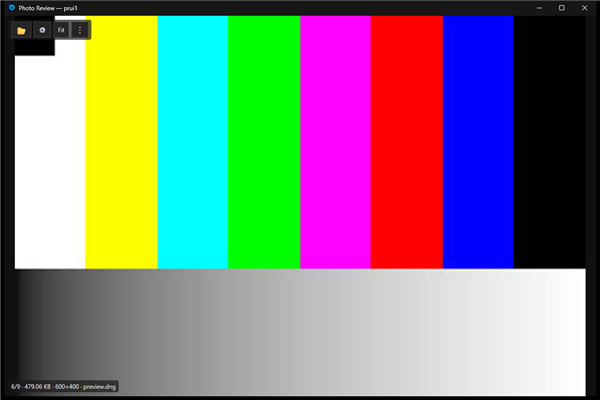
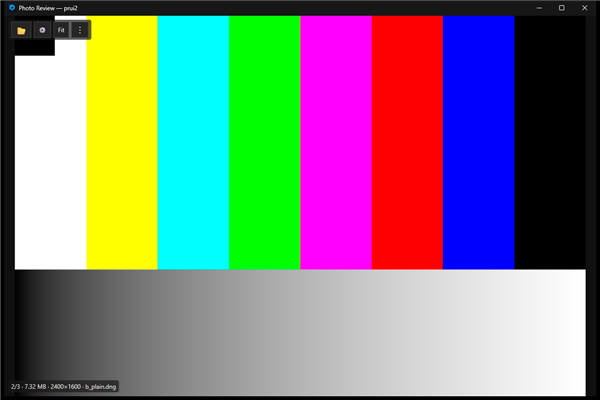

# Synthetic RAW evidence (2026-10-29, machine A, lane `synthetic-raw`)

Status: evidence report. Synthetic DNG files are NOT a camera corpus: they do not close any corpus row of
[`docs/PARITY.md`](../PARITY.md) (`X-raw-corpus`, `X-raw-native-libraw`, I-15 and friends stay Partial). They prove that a valid DNG of a
given shape is accepted, sized and routed as expected by our readers and by the real `libraw.dll`.

## What was generated

[`tools/dev/make-synthetic-raw.py`](../../tools/dev/make-synthetic-raw.py) (pure Python, no packages, run with `python -I`,
`selftest` mode parses headers and checks checksums and determinism). Output only into the directory given on the command line
(default `%TEMP%/photoreview-synthetic-raw`); nothing is committed.

- DNG 1.4 / TIFF little endian, 16 bit uncompressed (Compression 1), PhotometricInterpretation 32803 (CFA), RGGB
  (CFARepeatPatternDim 2x2, CFAPattern 0 1 1 2, CFALayout 1), BlackLevel 64, WhiteLevel 4095, DNGVersion 1.4.0.0,
  UniqueCameraModel, ColorMatrix1 (XYZ to linear sRGB, D65), AsShotNeutral 1 1 1, CalibrationIlluminant1 21, one strip, an Exif IFD.
- Scene: eight saturated colour bars, a grey ramp, a black marker square in the top-left corner (orientation is visible at a glance).
- Preview: baseline JPEG from a pure-Python encoder (4:4:4, flat custom quantisation tables, fixed-length canonical Huffman tables;
  valid but not size-optimal), stored with Compression 7 / Photometric 6 in a second IFD (`ifd0` layout: raw in IFD0, preview in the
  next IFD) or as IFD0 with the raw in a SubIFD (`subifd` layout, the Adobe DNG Converter shape).
- Set (600x400 default): `plain.dng` (no preview), `preview.dng` (preview 1/2), `subifd.dng`, `tinypreview.dng` (1/5), `swap.dng`
  (preview 1/4, the preview-to-full size swap file), `orient6.dng`, `orient3.dng`, `pair.dng` + `pair.jpg` (RAW+JPEG pair).

## Decoder results

| Decoder | Result |
|---|---|
| `pr_imaging_raw::readers::dng::DngContainerReader` | accepts all files; sensor size, preview sizes and orientation as written (both layouts) |
| `pr_libraw` `LibRawDecoder::read_info` / `decode` (pinned `libraw.dll` 0.22.2) | accepts `plain.dng`; size 160x96 (test) and 2400x1600 (exe); bars demosaic to the right colours (white, yellow, red, black asserted); `orient6.dng` reports the flipped size 96x160 |
| `pr_libraw::decoder::read_jpeg_thumbnail` (preview-only path) | returns the embedded JPEG of `preview.dng` (SOI, size 1/2); fails for `plain.dng` (no thumbnail) |
| `pr_imaging_raw::RawDecoder` + TurboJPEG | `ReadInfo` = sensor size, `decode` with a box serves the embedded preview (`embedded_preview_size` 1/2 or 1/4, `original_*` = sensor size, `downscaled`): the swap situation |
| Windows WIC (`BitmapDecoder`, built-in DNG codec) | accepts the `subifd` layout (frame = the 300x200 preview); rejects the raw-in-IFD0 layout ("No imaging component suitable"). Cause not isolated (extra ActiveArea/DefaultCrop tags did not help); our app decodes RAW through LibRaw first, so this is recorded, not acted on |

No LibRaw rejection occurred, so no generator fix was needed after the first valid layout. The first-pass JPEG encoder bug (zigzag
order) was found by the selftest/WIC check before any decoder run.

## Exe observations (real `PhotoReviewRs.exe`, isolated)

Every run used `PHOTOREVIEW_RS_DATA_ROOT` (fresh temp dir), `PHOTOREVIEW_RS_ISOLATE_CONFIG=1`, a unique `PHOTOREVIEW_RS_INSTANCE_PREFIX` and
`PHOTOREVIEW_RS_WARP=1`. Real `%LOCALAPPDATA%\PhotoReviewRs\config.json` was 2026-10-29 10:50:07, SHA-256 `DF7BFB4D...5DC6D`, and
`window-placement.json` 10:50:56, SHA-256 `E09243DB...02268` before and after: unchanged.

- Rendering: DNGs with an embedded preview show the preview (Fit); the DNG without a preview is decoded by LibRaw; colours are correct,
  neither black nor garbled. Previews smaller than the sensor (1/2, 1/4, 1/5) are upscaled in Fit and the status bar shows the sensor size.
  
  
- RAW+JPEG pair: the default `RawPairMode` is `Separate` in C# `AppSettings` and in Rust (not PreferJpeg): the folder shows 9 entries,
  `pair.dng` and `pair.jpg` separately. With `RawPairMode=1` (PreferJpeg) the pair is one entry (`pair.jpg` shown); Enter (Move to
  `Group-2`) moved `pair.dng`, `pair.jpg` and the sidecar `pair.xmp` together, `Ctrl+Z` restored all three (folder listing checked).
- Zoom to 100% (D1) on a 2400x1600 DNG with a 600x400 preview, `RawFullDecode=OnZoom` (and logging on): the view zoomed and arrow keys
  panned, but the picture stayed the upscaled preview (frames 60 ms, 700 ms and 10 s after the key are pixel-identical; they differ from the
  LibRaw decode of the same raw), and the log has no `ZoomDetail original ready` line. A control with a plain 2400x1600 JPEG also logged no
  zoom-detail load, so this is not RAW specific: the zoom-detail load (I-16) does not fire in the real exe in this scenario, and with it
  the preview-to-full swap and the re-anchor of PR #336 could not be observed. Status: OPEN, not fixed here (cause not isolated; the
  presenter integration rows of `X-zoom-detail-loader` are Partial in PARITY.md).

## Defects

| Finding | Root cause | Status |
|---|---|---|
| WIC rejects raw-in-IFD0 DNG | unknown (Windows codec or layout detail) | recorded; not a production defect of ours |
| Zoom detail / RAW full decode on zoom never swaps in the exe | not isolated; JPEG control behaves the same | open |
| Docs and the lane brief said the default pair mode is PreferJpeg | wrong premise: C# and Rust default is Separate | documented here |

## Not run

Camera-corpus runs, strict corpus mode, X-Trans / compressed / lossless-JPEG / maker-note DNGs, the C# oracle diff of the pair behaviour
beyond reading `CaptureGroup`/defaults, a side-by-side run of the C# exe.
